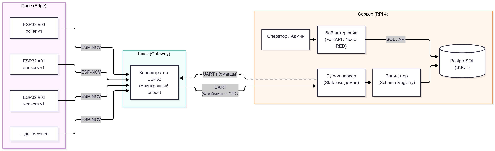
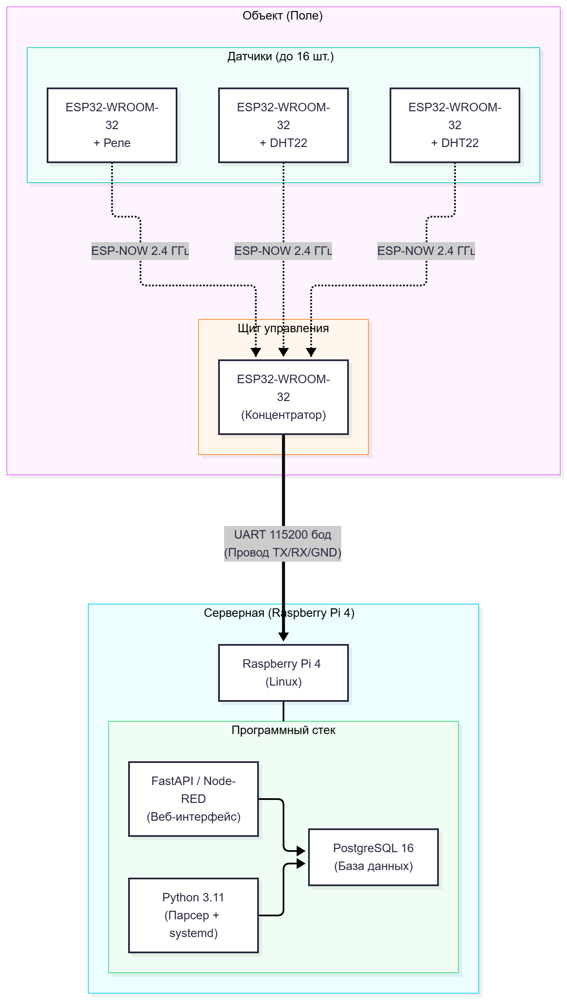
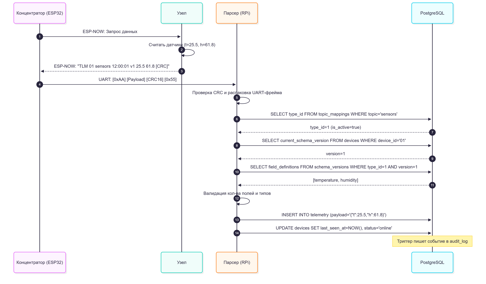
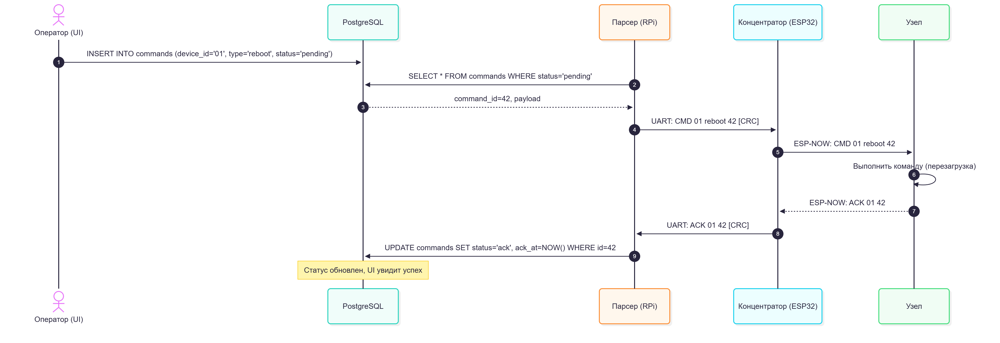
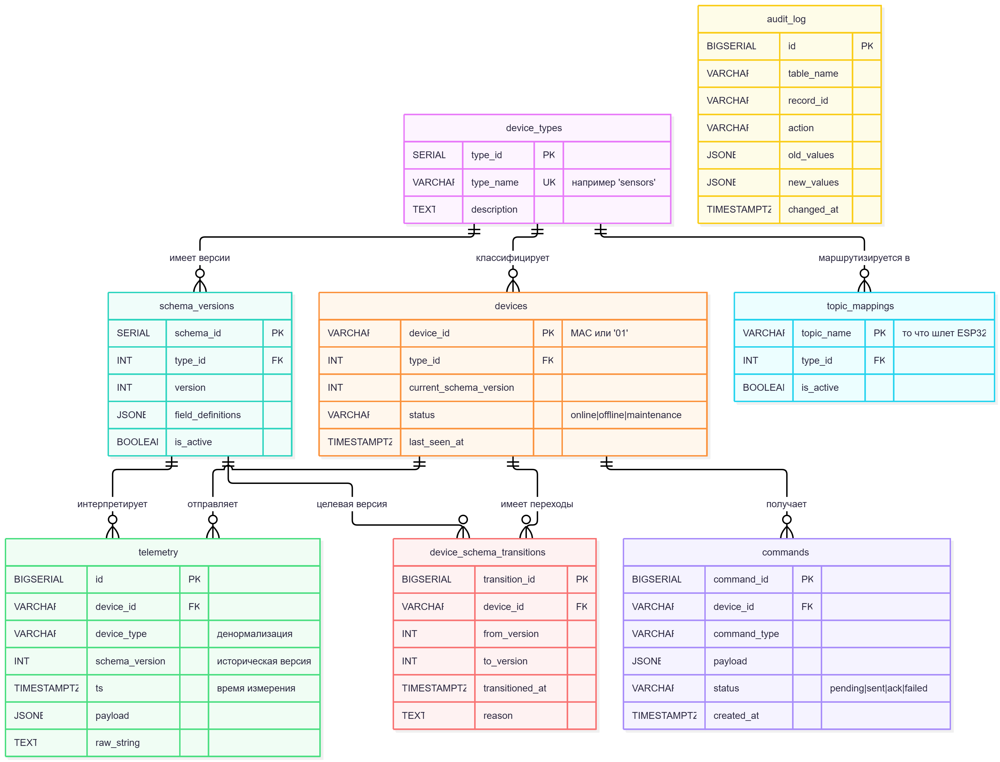
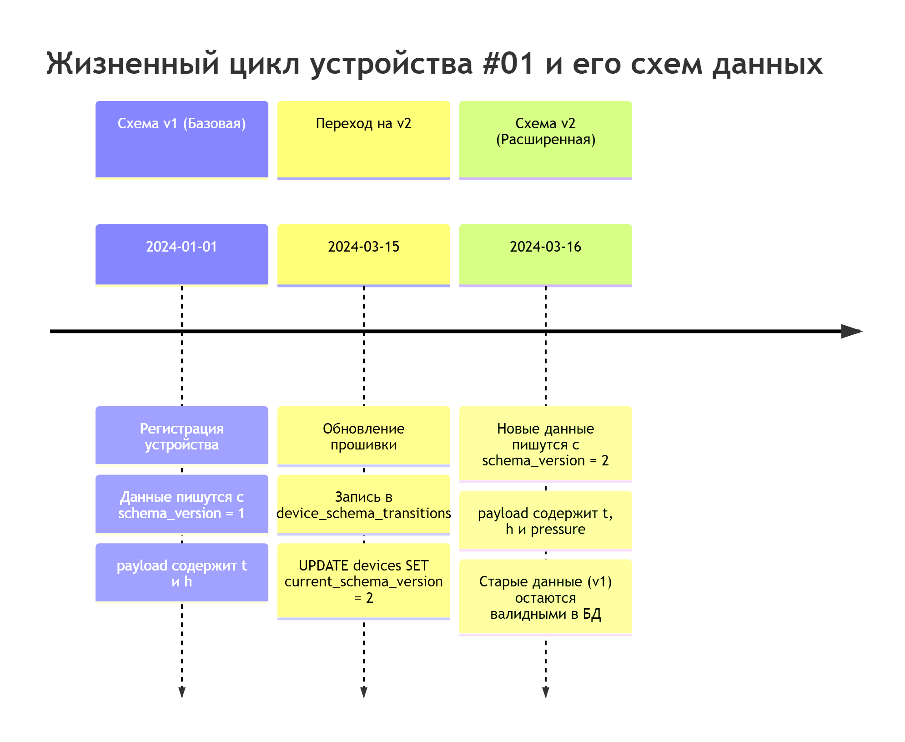
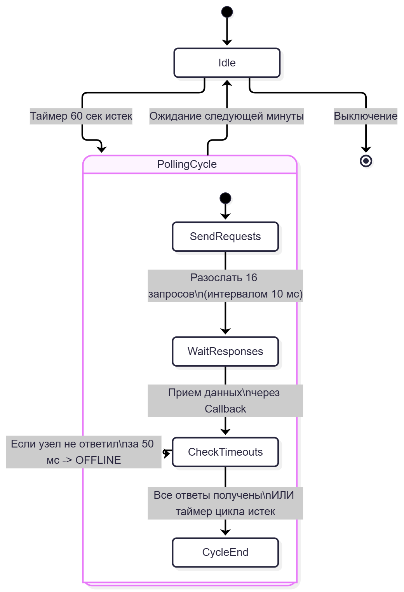
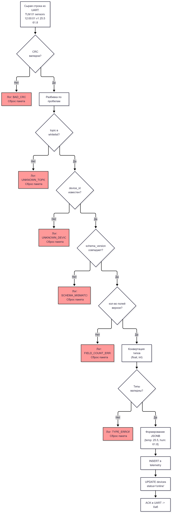
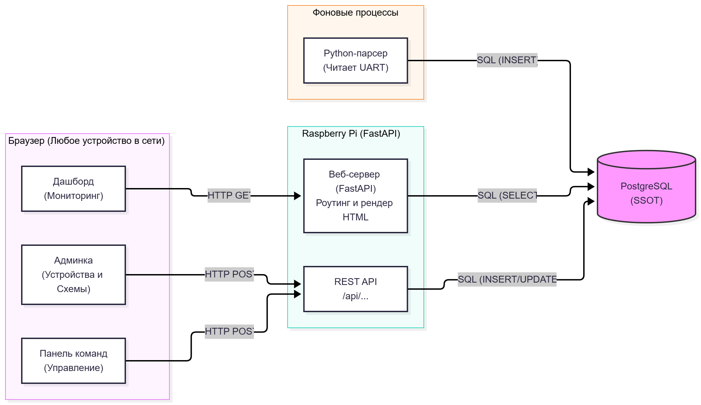
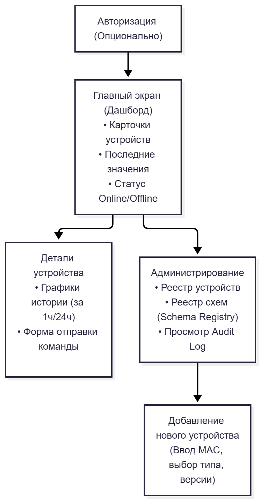

# Архитектурная концепция системы сбора и хранения телеметрических данных

## 1. Общие принципы и парадигма

Система спроектирована по гибридному принципу: строгое соблюдение внешних интерфейсов (протоколов обмена), заданных **[Техническим Заданием](./technical-specification-source.md)** (ТЗ) и **[Спецификацией протокола](./protocol-specification.md)**, при использовании современных, отказоустойчивых архитектурных паттернов внутри серверной части.

**Ключевые принципы:**

1. **Разделение ответственности (Separation of Concerns):** Микроконтроллеры занимаются только сбором и передачей «сырых» данных. Сервер занимается валидацией, обогащением и хранением.
2. **Слабая связанность (Loose Coupling):** Серверный парсер не зависит от структуры конкретной таблицы БД. Схемы данных управляются через реестр (Schema Registry).
3. **Single Source of Truth (SSOT):** Единственным источником достоверных данных является реляционная СУБД PostgreSQL. Остальные компоненты (парсер, интерфейс) — stateless.
4. **Stateless-компоненты:** Парсер и веб-интерфейс не хранят состояние в памяти. При сбое они перезапускаются и продолжают работу без потери данных.

## 2. Физическая и логическая топология

- **Уровень поля (Edge):** До 16 управляемых устройств на базе ESP32 (WROOM-32). Работают по протоколу ESP-NOW.
- **Уровень шлюза (Gateway):** Концентратор на ESP32. Выступает в роли Master-устройства и «моста» между радиоканалом и проводным интерфейсом UART.
- **Уровень сервера (Server):** Мини-компьютер Raspberry Pi 4 (или ПК). Выполняет роль сервера обработки данных и хранилища (PostgreSQL).

### 2.1. Компонентная схема

[Компонентная схема системы (Mermaid)](../diagrams/d2-components.mermaid)



### 2.2. Схема развертывания

[Схема развертывания (Mermaid)](../diagrams/d7-deployment.mermaid)



## 3. Протоколы и форматы данных (Прямой поток)

*Детальное описание контракта данных см. в файле [protocol-specification.md](./protocol-specification.md). Ниже приведены ключевые архитектурные особенности.*

### 3.1. ESP-NOW (Узел -> Концентратор)

Для минимизации накладных расходов данные передаются в виде текстовой строки.

Формат строки:
```txt
[Header] [Device_ID] [Topic] [Timestamp] [Schema_Ver] [Value_1] ... [Value_N]
```

Пример:
```txt
TLM 01 sensors 1714132801 v1 25.5 61.8
```

**Защита:** На уровне ESP-NOW используется аппаратная проверка целостности Wi-Fi. Дополнительная контрольная сумма (CRC) в самой строке не передается для экономии трафика. Пустые поля кодируются двойным пробелом.

### 3.2. UART (Концентратор -> Сервер)

UART — это поток байтов, поэтому используется фрейминг (кадрирование).

Формат кадра:
```txt
[Start Byte 0xAA] [Length] [Payload String] [CRC16] [End Byte 0x55]
```

**Зачем:** Защита от обрезания пакета и чтения «мусора» на стороне Raspberry Pi. Используется алгоритм CRC-16/CCITT-FALSE.

### 3.3. Обратный поток (Сервер -> Концентратор -> Узел)

Команды передаются в аналогичных фреймах, но с заголовком `CMD` и уникальным идентификатором команды `CMD_ID` (для связки с подтверждением ACK).

Пример:
```txt
CMD 01 42 set_interval 30
```

Каждая команда требует подтверждения (ACK), которое возвращается по цепочке обратно на сервер и фиксируется в БД.

### 3.4. Диаграммы последовательности

**Поток телеметрии (сбор данных):**

[Sequence: Поток телеметрии (Mermaid)](../diagrams/d3-sequence-data-flow.mermaid)



**Поток команд (управление):**

[Sequence: Поток команд (Mermaid)](../diagrams/d4-sequence-commands.mermaid)



## 4. База данных (Слой персистентности)

Для предотвращения «взрыва сущностей» (Entity Explosion) и сохранения нормализации, имя таблицы, передаваемое узлом (Topic), используется как **маршрутный ключ**, а не как буквальное имя SQL-таблицы.

Структура БД:

1. `device_types` — справочник классов устройств (sensors, boiler).
2. `schema_versions` — реестр версий протокола. Хранит JSONB с описанием полей (позиция, имя, тип). Позволяет обновлять прошивки узлов без миграций БД.
3. `devices` — справочник физических узлов (текущая версия схемы, статус, время последнего пакета).
4. `telemetry` — основная таблица данных. Хранит timestamp, device_id, schema_version (историческую на момент записи) и payload в формате JSONB.
5. `commands` — журнал команд с отслеживанием статуса (pending, sent, ack, failed).
6. `device_schema_transitions` — история смены версий прошивок.
7. `audit_log` — универсальный журнал изменений конфигурации, заполняется через триггеры СУБД.

**Примечание:** Почему JSONB? Это позволяет добавлять новые датчики и поля (например, давление в схеме v2) без создания новых таблиц и сложных миграций (ALTER TABLE).

### 4.1. ER-диаграмма базы данных

[ER-диаграмма БД (Mermaid)](../diagrams/d1-er.mermaid)



### 4.2. Жизненный цикл схем данных

[Timeline версионирования (Mermaid)](../diagrams/d8-timeline.mermaid)



## 5. Отказоустойчивость и алгоритм опроса (Asynchronous Polling)

**Проблема:** Блокирующий опрос (когда концентратор ждет ответа от каждого узла) приводит к «Head-of-Line Blocking». Если один узел сломан, он задерживает опрос остальных 15.

**Решение:** Внедрение неблокирующего конечного автомата (State Machine) на концентраторе.

1. Концентратор рассылает запросы всем 16 узлам.
2. Система не ждет. Для каждого узла запускается индивидуальный таймаут (например, 50 мс).
3. Если узел не ответил за 50 мс, он помечается как Offline до следующего цикла. Опрос остальных продолжается.
4. Прием данных осуществляется асинхронно через прерывания (Callbacks).

### 5.1. Конечный автомат концентратора

[State Machine концентратора (Mermaid)](../diagrams/d5-state-master-polling.mermaid)



### 5.2. Конвейер валидации данных

[Flowchart валидации (Mermaid)](../diagrams/d6-flowchart.mermaid)



**Обработка сбоев (Failure Modes):**

- _Падение узла:_ Изолируется таймаутом. Остальные работают.
- _Падение концентратора:_ Watchdog (WDT) на ESP32 вызывает перезагрузку.
- _Падение парсера (Python):_ systemd перезапускает службу (так как она Stateless).
- _Недоступность БД:_ Парсер буферизирует данные локально и выполняет Retry.

## 6. Пользовательский интерфейс и Латентность

### 6.1. Разделение UI и Бэкенда («Тонкий клиент»)

- **Бэкенд (Парсер):** Работает как системный демон (systemd) 24/7. Читает UART, пишет в БД.
- **Фронтенд (UI):** Отдельное веб-приложение (FastAPI / Node-RED / Streamlit).

**Преимущество:** UI можно закрыть, перезагрузить или открыть с другого компьютера в сети, не прерывая процесс сбора телеметрии. UI работает как «проекция» базы данных.

[Взаимодействие UI и Бэкенда (Mermaid)](../diagrams/d9-ui-interaction.mermaid)



### 6.2. Анализ латентности

- **Магистраль (ESP-NOW -> UART -> Парсер -> БД):** Занимает ~10–30 мс.
- **Общая задержка:** Определяется ТЗ (опрос раз в 60 секунд).
- **Масштабирование:** При необходимости система легко переводится в режим 1–3 секунд (за счет асинхронности и батчинга в БД). Для частот < 1 секунды в «Перспективах развития» предусмотрена гибридная Event-Driven модель (датчики шлют данные только при выходе за пороги, плюс Heartbeat-пинги).

## 7. Подсистема «Историзатор»

### 7.1. Функциональные блоки интерфейса

Минимально жизнеспособный интерфейс (MVP) включает 4 ключевых экрана:

1. **Дашборд (Мониторинг):** Сетка карточек всех 16 устройств. Отображает `device_id`, `type`, `status` (Online/Offline), время последнего пакета (`last_seen_at`) и последние значения из `JSONB` (например, `temperature`, `humidity`).
2. **Управление (Команды):** Форма отправки команд конкретному устройству. Включает выпадающий список доступных команд (из справочника), поле для параметров и таблицу истории команд со статусами (`pending` -> `sent` -> `ack` / `failed`).
3. **Администрирование:** Экран для добавления новых устройств (ввод MAC, выбор типа и версии схемы) и просмотра реестра схем (`schema_versions`).
4. **Историзатор (Просмотр истории):** Экран для глубокого анализа накопленных данных (описан ниже).

### 7.2. Карта экранов (Site Map)

[Карта экранов UI (Mermaid)](../diagrams/d10-screen-map.mermaid)



### 7.3. Экран истории (History Viewer)

Экран истории предназначен для просмотра накопленных данных за произвольный период. Благодаря использованию типа `JSONB`, система позволяет строить гибкие запросы без изменения структуры БД.

Экран истории включает:

- **Временной фильтр:** Выбор периода (1 час, 24 часа, 7 дней, произвольный диапазон).
- **График (Time-Series):** Визуализация изменения параметров (например, температуры) с агрегацией данных по часам. Реализуется через Chart.js.
- **Таблица сырых данных (Raw Data):** Постраничный вывод последних N записей с отображением точного времени (timestamp) и JSON-полезной нагрузки (payload).
- **Экспорт (CSV):** Возможность выгрузить историю в файл для последующего анализа в Excel или научных пакетах (Python/Matplotlib).

**SQL-запрос для графика (Агрегация):**

Используется встроенная функция PostgreSQL для группировки по времени:

```sql
SELECT
    date_trunc('hour', ts) AS bucket,
    AVG((payload->>'temperature')::float) AS avg_temp
FROM telemetry
WHERE device_id = '01'
  AND ts >= NOW() - INTERVAL '24 hours'
  AND payload ? 'temperature'
GROUP BY bucket
ORDER BY bucket;
```

**SQL-запрос для таблицы (Сырые данные):**

Обязательно ограничивается лимитом и смещением (пагинацией) для предотвращения перегрузки Raspberry Pi:

```sql
SELECT ts, payload
FROM telemetry
WHERE device_id = '01'
ORDER BY ts DESC
LIMIT 50 OFFSET 0;
```

### 7.4. Оптимизация производительности

- **Индексы:** Для быстрой работы историзатора в БД созданы индексы: idx_telemetry_dev_ts (по device_id и времени) и GIN-индекс idx_telemetry_payload (для поиска по JSONB-полям).
- **Асинхронность:** Использование FastAPI (async/await) позволяет обрабатывать запросы к истории, не блокируя основной поток чтения UART.
- **Кэширование (задел на будущее):** При росте нагрузки тяжелые агрегированные запросы можно вынести в материализованные представления (Materialized Views) или TimescaleDB.

## 8. Резюме (Готовность к MVP)

Реализация протоколов обмена (ESP-NOW, UART, строковые посылки с именем таблицы) полностью соответствует исходному ТЗ и зафиксирована в Спецификации.

Архитектурные решения на уровне серверной части:

- Внедрение Schema Registry, защищающего БД от изменений в протоколе (поле "имя таблицы" используется как маршрутный ключ).
- Реализация неблокирующего опроса, гарантирующего, что отказ одного из 16 узлов не остановит сбор данных со всей системы.
- Серверный парсер отделен от веб-интерфейса, что позволяет мониторить систему удаленно без риска прерывания записи данных.
- Все данные проходят валидацию по CRC на уровне UART, что исключает запись мусора в базу при помехах в проводе.

Это делает систему готовой к промышленной эксплуатации и легкому масштабированию при добавлении новых типов датчиков.